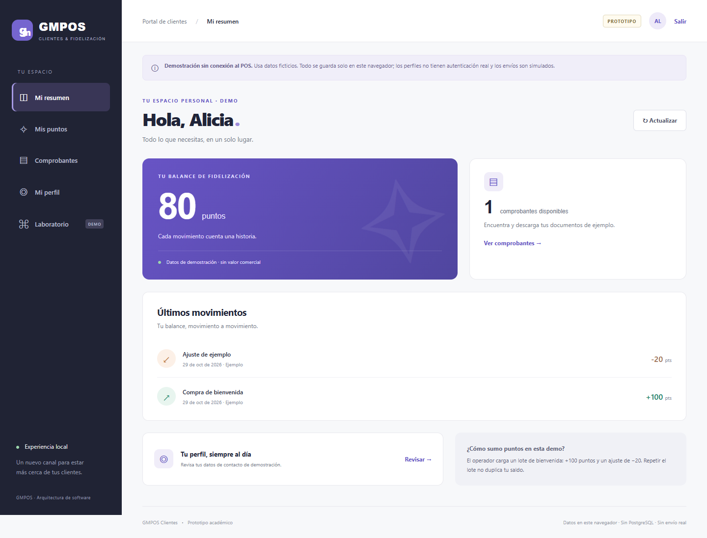

# GMPOS · Clientes y fidelización

Prototipo navegable de un segundo canal para clientes de GMPOS. Implementado con Next.js, React y TypeScript; **sin PostgreSQL, Supabase ni conexión al POS**, por decisión de Carlos del 29 de octubre de 2026.



Permite crear perfiles de ejemplo, editar sus datos, consultar puntos, descargar comprobantes PDF de demostración y solicitar un envío simulado. El laboratorio permite importar un lote sin duplicarlo, procesar la cola y simular fallos. Los cuatro patrones solicitados tienen implementación y pruebas: Singleton, mensajería asíncrona, Observador y Fachada.

## Ejecutar

Requisito: Node.js 22 y npm. Las versiones resueltas están en `package-lock.json`.

```sh
npm ci
npm run dev
```

Abrir `http://localhost:3000`. **No se necesitan variables de entorno, claves ni cuentas de servicios.**

Para revisar la versión de producción:

```sh
npm run build
npm start
```

## Montar en Vercel

Carlos realizará este paso. El repositorio contiene la aplicación en su raíz.

1. Importar `carlosalbertogarciasalas/arquitecturasoftware` en Vercel.
2. Seleccionar **Next.js**, raíz `./`, Node.js **22.x**.
3. Usar instalación `npm ci` y compilación `npm run build`. Conservar la carpeta de salida predeterminada de Next.js.
4. No agregar variables de base de datos ni credenciales.
5. Desplegar y probar registro, PDF y cola desde la URL resultante.

Los datos viven en **IndexedDB del navegador, por origen web**. Cambiar de dominio, navegador o dispositivo crea un espacio diferente. Recargar conserva los datos; borrar almacenamiento, usar navegación privada o la limpieza automática del navegador puede eliminarlos. No hay sincronización ni respaldo remoto.

## Recorrido de demostración — 5 minutos

1. **Explorar como cliente → Alicia**: saldo 80, dos movimientos y un comprobante ya preparados como ejemplo.
2. **Comprobantes → Descargar PDF**: documento marcado «DEMOSTRACIÓN SIN VALIDEZ FISCAL».
3. **Solicitar envío simulado**: permanece PENDIENTE; repetir no crea otra solicitud.
4. **Salir → Abrir laboratorio de operador → Procesar pendientes**: completa la simulación. No se envía un correo.
5. Volver a Alicia y comprobar «Simulación completada».
6. Crear otro perfil o elegir Daniel; cargar su lote desde el laboratorio. Repetir el lote conserva saldo 80 y un solo comprobante.
7. Para mostrar fallos, solicitar el envío de Daniel y activar «Simular fallo del adaptador». Reintentar después de 5 segundos y luego 30; el tercer fallo queda FALLIDO. Desactivar la opción antes del último intento demuestra recuperación.

## Límites del prototipo

- El selector de perfiles **simula acceso**; no autentica personas. Cualquier visitante del mismo navegador puede elegir cliente u operador.
- Las comprobaciones de la Fachada demuestran separación lógica, **no seguridad de servidor**. Los datos del navegador pueden inspeccionarse o modificarse. Usar únicamente información ficticia.
- Los PDF se generan localmente; no son facturas electrónicas, no tienen firma fiscal ni enlaces privados temporales.
- La cola es durable mientras se conserva IndexedDB. El consumidor se activa manualmente; no funciona con todas las pestañas cerradas ni envía correo real.
- El único endpoint HTTP, `/api/demo/ping`, es una comprobación sin datos de negocio para el ensayo de nodos/hilos. La app no utiliza ese endpoint para almacenar información.
- El despliegue Vercel y la comprobación sobre una URL pública quedan a cargo de Carlos. No se presentan como ya realizados.

## Patrones y pruebas

| Patrón | Implementación | Qué se demuestra |
|---|---|---|
| Singleton | [DemoConfig](src/domain/config.ts) | Una configuración congelada por copia del módulo; sin estado de clientes |
| Mensajería asíncrona | [claim / complete / consume](src/domain/facade.ts), [IndexedDbRepository](src/infrastructure/indexed-db.ts) | Producción/consumo separados, transacciones, lease, token, reintento e idempotencia |
| Observador | [Subject](src/domain/observer.ts), [PointsCard / History](src/components/portal.tsx) | Ambos componentes reciben snapshots; cancelación y descarte de respuestas viejas |
| Fachada | [LoyaltyFacade](src/domain/facade.ts) | Registro, perfil, saldo, documentos y cola mediante una interfaz de operaciones |
| Adapter | [Repository](src/domain/model.ts), [DeliveryAdapter](src/domain/facade.ts) | Persistencia sustituible y transporte simulado |
| Strategy | [FullHistory / CursorHistory](src/domain/strategy.ts) | Navegación completa o paginada con resultados equivalentes |

```sh
npm run typecheck
npm test
npm run build
npm run test:e2e
npm run demo:navigation
npm run demo:threads
```

Las pruebas de navegador requieren Edge en Windows. En Linux/macOS instalar `npx playwright install chromium`; la configuración selecciona Chromium. Se puede cambiar con `PLAYWRIGHT_CHANNEL`. Ejecutar `build` antes de `test:e2e`: las pruebas utilizan la compilación de producción en el puerto 3100.

Para incorporar comunicación HTTP al ensayo de hilos, iniciar `npm start` y ejecutar `npm run demo:threads -- http://localhost:3000`. No se debe interpretar ese resultado como medición en nube.

Se incluye un flujo de GitHub Actions para tipos, pruebas, build y navegador. Su resultado remoto debe consultarse en Actions; las verificaciones locales se documentan en [VALIDACION.md](docs/VALIDACION.md).

## Documentación

- [Arquitectura implementada y cambio de alcance](docs/ARQUITECTURA.md).
- [Decisión: prototipo sin PostgreSQL](docs/ADR-001-prototipo-local.md).
- [Validación, resultados y limitaciones](docs/VALIDACION.md).
- [Diseño previo editable en Lucid](https://lucid.app/lucidchart/0cdee5ed-b7bd-42b6-89b8-b3d80e9db70c/edit). Las vistas TO-BE describen también una etapa futura con Supabase; no deben confundirse con esta variante local.

El monolito GMPOS y sus credenciales no están incluidos en este repositorio.
